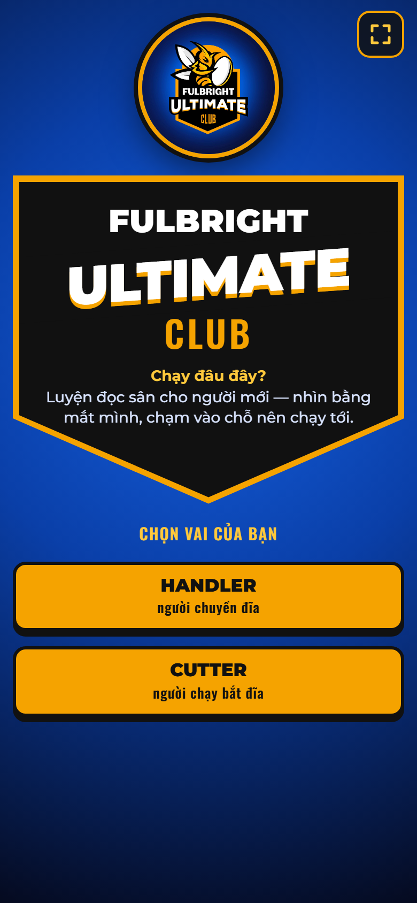
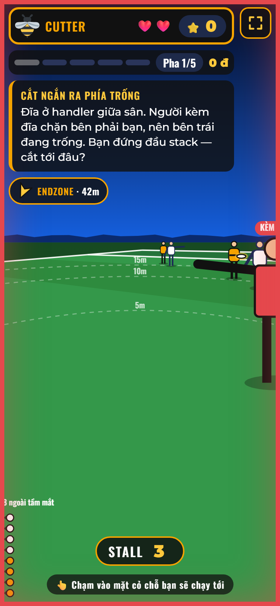
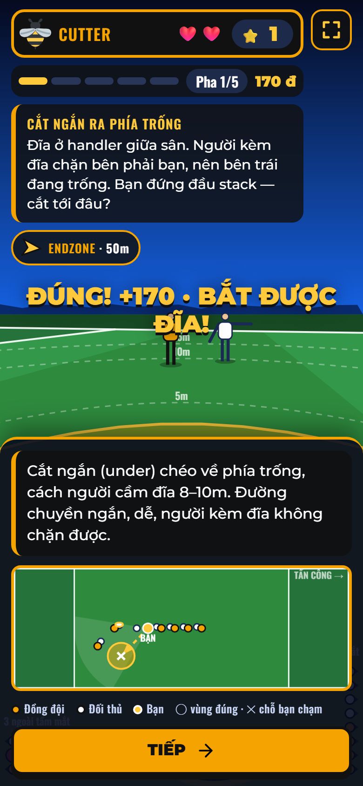
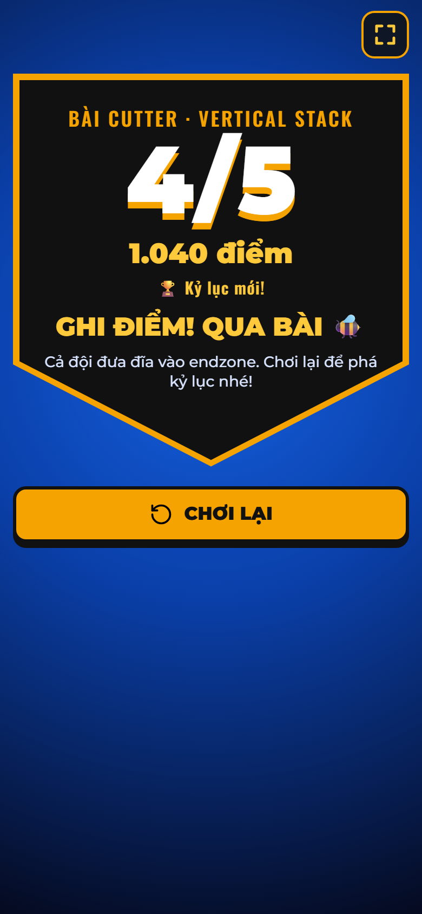

# Chạy Đâu Đây? — "Where do I run?"

**Learn to read an Ultimate Frisbee field from your own eyes, one point at a time.**

▶ **Play now (mobile or desktop):** https://chuoiuhuhu0727.github.io/chay-dau-day/
🎬 **Demo video (2–3 min):** _TODO — paste the YouTube / Drive link here_

<p>
  
  
  
  
</p>

## Pitch

*Chạy Đâu Đây?* is a mobile web game for new Ultimate Frisbee players. You are standing **on the field, at eye level**.
The disc is with a handler, a defender is right in front of you and the stall count is ticking.
You tap the grass where you would run. The game judges your choice right away. It shows the open space you should have
attacked on a top-down diagram, with one sentence on *why*. Five plays make one point. Two mistakes and it is a turnover.
Chain right reads into combos and beat your best score. A 3-minute session before practice teaches what normally takes
a season of being yelled at to "get open!".

## The problem

- Beginners in a club like **Fulbright Ultimate Club** know the rules but not **where to stand**. In a vertical stack
  they clog the lane, cut into the same space as a teammate, or freeze when the mark is on.
- Field positioning is taught with whiteboards and top-down diagrams. That is not what a player sees. On the field you
  see bodies at eye level, a moving defender, and a stall count in your ear. Translating "the arrow on the board" into
  "that patch of grass over there" is the hard part. You only get to practise it during scarce, crowded field time.
- Captains repeat the same explanations to every new batch of players each semester.

## Target users

| Who | Need | How they use it |
|---|---|---|
| **Primary:** new club players (18–25, university students; first is Fulbright Ultimate Club) | Know where to run as a Handler or Cutter in a vertical stack | 2–5 minutes on the phone before practice, on the bus, between classes |
| **Secondary:** captains and coaches | A shared tool to onboard beginners and give "homework" between practices | Send the link in the team chat; discuss the scenarios people miss |

## Core features

All features are specified in [`1-wiki/features/`](1-wiki/features/). Each page has a *Done when* checklist that the tests check.

| # | Feature | What the player gets |
|---|---|---|
| F1 | First-person field | The field drawn in perspective from your eyes (canvas 2D pinhole camera). A tap on the grass becomes a real (x, y) position in metres. |
| F2 | Scenario set | 10 vertical-stack offence scenarios: 5 for **Handler**, 5 for **Cutter** |
| F3 | Club-style start screen | Fulbright Ultimate Club look (blue gradient, black-and-gold crest, bee mascot). Pick your role. |
| F4 | Tap to choose + judging | Tap where you would run. Correct within a 4 m zone. Instant feedback (bounce / shake). |
| F5 | Answer | The correct zone lights up, plus a top-down mini-map with an arrow and a one-line "why" |
| F6 | End of a point | X/5. **Score** (pass) or **Turnover** (try again). |
| F7 | Target endzone | The endzone you attack is highlighted. A compass shows its direction and distance. |
| F8 | Live play | A defender marks you up close and everyone keeps moving while you think. After you tap, you run and the disc flies. |
| F9 | Fullscreen | The field fills the whole screen. The HUD sits on top of it. Fullscreen button; works in portrait and landscape. |
| F10 | One continuous point | **2 lives**, a 10-second **stall count** like real Ultimate, **combo** scoring, a best score saved on the device |
| F11 | Event tracking | 8 events through one `track()` function, GA4-ready (see the tracking plan below) |

The core loop runs end to end: open → pick a role → play 5 phases → result → play again. It works on a 375 px phone and on desktop.

## Launch channel and growth

**Channel: the open web**, hosted on GitHub Pages: https://chuoiuhuhu0727.github.io/chay-dau-day/

Why the open web first:
- **Zero install friction.** A link in a team group chat or a QR code on the practice field opens the game in one tap.
  This matters for a niche audience that will not search an app store for "ultimate frisbee positioning".
- Fastest iteration: a fix goes live about 30 seconds after a push. No store review.
- Round 2 path: wrap the same web app for **Google Play** (Trusted Web Activity / WebView). We don't have to rewrite it.

How it gets users:
1. **Seed:** Fulbright Ultimate Club. Captains share the link with each new batch of players and use it as onboarding homework.
2. **Spread through the community:** university and city Ultimate clubs in Vietnam talk in Facebook / Zalo groups. One club
   finding it useful is the pitch to the next. QR codes at tournaments and clinics.
3. **Built-in loop:** the score and best score give a reason to replay and to compare with teammates. A shareable result
   card is planned for Round 2.

## Revenue path

Nothing is monetised in Round 1. We want proof that players come back first: `retry_click`, sessions per player.
The plan, in order:

1. **Rewarded ads, opt-in:** "watch an ad to get your 2nd life back" fits the life mechanic and never blocks the
   free game. This comes with the Google Play version, where ad SDKs are standard.
2. **Scenario packs, in-app purchase:** horizontal stack, zone offence, defence (cup, force), endzone sets.
   Writing a scenario is cheap because a scenario is data, not code (see `SCENARIOS` in [`game/logic.js`](game/logic.js)).
3. **Club / coach plan, small subscription:** a club gets its own scenario pack (its own plays, its own logo) and a dashboard
   of which scenarios its players miss. This data comes straight from the `phase_answer` events.

## How to access, build and run

**Just play:** open https://chuoiuhuhu0727.github.io/chay-dau-day/ on any modern phone or desktop browser.

**Run locally** (needs Node.js ≥ 22; no install step, no build, no dependencies):

```bash
node 2-environment/serve.mjs        # → http://localhost:5173
```

**Test:**

```bash
node --test game/tests/             # 50 unit tests for the game rules (logic.js, track.js)
bash test.sh                        # a bot plays the game in Chrome and writes a report with screenshots
bash 3-verification/verify.sh       # the full gate: unit tests + bot run (89 checks); marks features ✅ only when green
```

**Deploy:** the site is the `game/` folder. The `gh-pages` branch is a subtree of it:

```bash
git branch -D gh-pages; git subtree split --prefix game -b gh-pages
git push chay-dau-day gh-pages:gh-pages --force
```

**Turn on analytics:** paste a GA4 Measurement ID (`G-…`) into [`game/track-config.js`](game/track-config.js).
If it is empty, nothing leaves the device.

Tech: plain HTML/CSS/JavaScript ES modules, Canvas 2D, no framework, no build step
(decision: [`1-wiki/decisions/js-thuan-khong-build.md`](1-wiki/decisions/js-thuan-khong-build.md)).
The game rules are pure functions in `game/logic.js`. The DOM and drawing code is in `game/ui.js`.

## Tracking plan

Every event goes through one function, `track(name, params)` in [`game/track.js`](game/track.js). Each event is:
- validated against the plan below (an unknown event or a missing parameter is rejected);
- stored in `window.__events` and `window.dataLayer`;
- sent to **Google Analytics 4** when `GA_ID` is set.

Moving to Firebase or PostHog in Round 2 means editing only `track.js`.
Each event exists to answer a product question. We don't count things for fun.

| Event | When | Parameters | What it measures · why it matters |
|---|---|---|---|
| `game_open` | Page opens | `screen_w`, `screen_h`, `fullscreen_supported` | Top of the funnel. Portrait vs landscape share tells us which layout to polish first. |
| `role_select` | Tap Handler / Cutter | `role` | Which role attracts beginners → write new scenarios for that role first. |
| `point_start` | A point starts | `role`, `attempt` (nth point this session) | Funnel `game_open → point_start`: does the start screen convince people to play? |
| `phase_answer` | Each phase is judged | `role`, `scenario_id`, `phase` (1–5), `outcome` (`correct` / `wrong` / `stall`), `stall`, `combo`, `gain`, `decide_ms` | **The key event.** Miss rate per `scenario_id` shows which scenario is too hard or badly explained. `decide_ms` and the `stall` rate show whether the 10-second stall is too harsh. |
| `explanation_read` | Tap Next after the answer | `scenario_id`, `outcome`, `read_ms` | Do players read the explanation (the learning value)? `read_ms` < 1 s means they skipped it. |
| `point_end` | A point ends | `role`, `result` (`score` / `turnover`), `correct`, `points`, `phases_played`, `duration_ms`, `new_best`, `attempt` | Pass rate (overall difficulty) and session length. A `point_start` with no `point_end` is a **drop-off**, and we can see at which phase. |
| `retry_click` | Tap Play again | `role`, `last_result`, `attempt` | **The main retention signal:** do people want "one more point"? This was the goal of F10. |
| `fullscreen_toggle` | Tap ⛶ | `on` | Does anyone use fullscreen (F9)? Keep it or drop it. |

**Round 2 metrics:**
- `game_open → point_start` conversion
- score rate
- points per player (`retry_click`)
- miss rate and median `decide_ms` per `scenario_id`
- `stall` rate
- median `read_ms`

Tests check the plan itself: [`game/tests/F11.test.js`](game/tests/F11.test.js) (exactly 8 events, required parameters, PII rejected).
The bot also plays the game and asserts that each event fires with the right values.

## Privacy and policy compliance

- **No personal data.** No account, no name, email or location. `makeEvent` throws if a parameter is called
  `name`, `email`, `phone`, `user` or `ip`.
- **Analytics off by default.** With `GA_ID` empty the page loads no third-party script. When GA4 is on, Google Signals
  and ad personalisation are disabled.
- The only thing stored on the device is the best score (`localStorage`, key `cdd-best-<role>`).
- No ads, no purchases, no external links in Round 1. Content is sports education, suitable for all ages.
- **Before publishing:** add a short privacy notice if GA4 is turned on, and confirm the club's permission to use
  the Fulbright Ultimate Club logo (or swap it for a generic crest).

## AI-native workflow

We built the whole product with **Claude Code (Claude Opus) in the Claude desktop app**, inside a small **harness**
from Apero's hands-on session. The harness template is in this repo; its first commits are by `Liem-TV-Apero` and the
details are in [HARNESS.md](HARNESS.md). The idea: *the AI does the work, but it only counts as done when a machine proves it.*

```
① Wiki (1-wiki/)          the source of truth: raw idea → overview → one page per feature with "Done when"
② Environment             Claude runs commands itself: tests, a local server, a Chrome bot, git
③ Verification            bash 3-verification/verify.sh = the only thing that can mark a feature ✅
④ Memory (4-memory/)      feature status, progress log, open questions for the product owner
```

How we used Claude at each stage:

| Stage | What we did |
|---|---|
| **Ideation** | We wrote the raw idea in our own words ([`1-wiki/raw/idea.md`](1-wiki/raw/idea.md)). `/game` asked us 5 multiple-choice questions (quiz vs animation, camera angle, win rule, formation, role) and turned the answers into [`overview.md`](1-wiki/overview.md). |
| **Specs** | Claude wrote one wiki page per feature with a *Done when* list. New ideas went into new raw files (`idea-2.md`: target endzone + a defender marking you; `idea-3.md`: "make it move like a real match") and became F7–F8. |
| **Code** | `/build`: for each feature Claude wrote the tests first, ran them red, wrote the code until green, then "claimed" the feature 🟡. |
| **Testing** | Unit tests (`node:test`) for the rules. A Chrome bot plays the game at phone size (390 × 844) through [`game/e2e.mjs`](game/e2e.mjs), checks every *Done when* line, and takes screenshots. It also checks design: no default fonts, no horizontal overflow, tap targets ≥ 40 px. |
| **Iteration** | We play-tested and wrote feedback in plain language ("it feels like a quiz, not a game", "I want fullscreen"). Claude proposed changes and updated the wiki first, then tests, then code: F9 fullscreen, F10 lives / stall / combo, F11 tracking. |
| **Decisions left to us** | When the wiki was unclear, Claude did not guess silently. It picked the most reasonable option and logged a question in [`4-memory/po-questions.md`](4-memory/po-questions.md), e.g. "2 or 3 lives?", "10 or 15 s stall?". |
| **Ship** | Claude deployed to GitHub Pages and opened the live URL at phone size to check that it loads, that events fire, and that the console has no errors. |

Timeline (from git):
- **Oct 28:** harness from Apero.
- **Oct 30:** first playable game, F1–F8 in one day.
- **Nov 15:** fullscreen, the new game loop, tracking, and the public launch.

### What worked

- **"Only verify.sh can say done" caught real bugs.** One example: the turnover screen said "Turnover — chưa qua"
  while the spec said "Chưa qua". The bot failed, and Claude fixed the UI text instead of loosening the test.
- **Wiki first, then code.** Changing the game loop (F10) meant rewriting F6's rule ("5 phases, ≥ 4/5" became
  "2 lives, turnover early"). Because the rule lived in one wiki page plus its tests, the change was clean and nothing
  else broke.
- **A bot that plays like a user.** It caught layout bugs a unit test never would: the fullscreen button overlapping the
  result crest, the answer sheet hiding the feedback in landscape.
- **Product questions stayed with humans.** The PO-question log kept us deciding the *what* (difficulty, lives, stall)
  while Claude handled the *how*.
- **Speed.** From a raw idea to a playable first-person game in one day; three major features plus launch in one more.

### What didn't work (and what we learned)

- **Flaky checks.** One F8 check ("the defender moved ≥ 2 px in 300 ms") sometimes failed: both samples landed at
  symmetric points of the defender's sway. We did *not* loosen the test. We logged it in
  [`1-wiki/learned.md`](1-wiki/learned.md) with a better design: take the maximum offset over several samples.
- **Slow page load gave false reds.** The bot sometimes failed "game opens" because the page was still loading, not
  because the game was broken. Lesson: re-run the bot alone to separate a flaky environment from a real bug.
- **Environment problems cost more time than code.** The machine had no usable Node at first, and Claude initially
  said it could not install it. It could (via winget) once asked. The GitHub token lacked the `workflow` scope, so we
  deployed with a `gh-pages` subtree instead of GitHub Actions. Lesson: ask the AI to check its tools, don't accept "I can't".
- **3D is still out of reach for this stack.** We wanted a game-like 3D look (rich background, animated players).
  Plain canvas 2D with no libraries cannot get there cheaply, so 3D is deferred to Round 2 as a deliberate decision
  instead of a half-done feature.
- **AI-written content still needs an expert.** The 10 scenarios were written by Claude from general knowledge of the
  vertical stack. The club captains still need to review them (open PO question).
- _TODO (team): add 1–2 things from your own experience, e.g. prompts that worked or didn't, time spent, surprises._

## Team

| Member | Role | Contributions |
|---|---|---|
| _TODO name_ | _e.g. Product owner / game design_ | _e.g. idea, scenario review, play-testing, PO decisions_ |
| _TODO name_ | _e.g. AI build lead_ | _e.g. ran Claude Code / harness, reviewed code and tests, deploy_ |
| _TODO name_ | _e.g. Tracking & growth_ | _e.g. tracking plan, GA4 setup, launch in club groups_ |
| _TODO name_ | _e.g. Demo & docs_ | _e.g. demo video, README, user interviews_ |

## Repository map

```
game/                 the product (this folder is the website)
  index.html  ui.js   screens, drawing, input
  logic.js            pure game rules + the 10 scenarios
  track.js            event tracking (track-config.js holds the GA4 ID)
  e2e.mjs  tests/     bot script + unit tests
1-wiki/               specs: overview, features F1–F11, screens, decisions, lessons learned
2-environment/        dev server, Chrome bot, AI working rules
3-verification/       verify.sh — the gate
4-memory/             feature status, progress, PO questions
docs/screens/         screenshots for this README (taken by the bot)
HARNESS.md            how the AI harness works (template from Apero)
```

## Roadmap (Round 2)

- Turn on GA4, publish a privacy notice, and read the first real data (see the metrics above).
- Google Play build (TWA) and opt-in rewarded ads.
- More scenarios: horizontal stack, defence. Have club captains review them.
- 3D field and players. Shareable result card.
- Answer open PO questions using data: 2 vs 3 lives, 10 vs 15 s stall.

---

*Products that pass Apero's gating are published under Apero's name; copyright belongs to Apero (per the assignment brief).*
